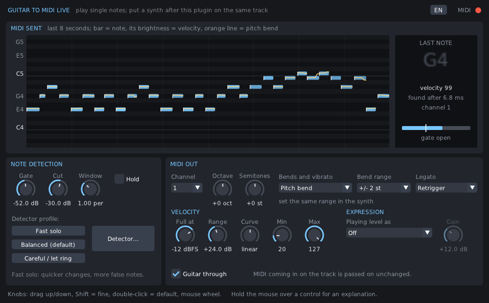

# Guitar to MIDI Live

Guitar to MIDI. The plugin listens to single notes played on the guitar and sends them out as MIDI: notes with velocity,
bends and vibrato as pitch bend, and the playing level as a controller (CC). Put any synthesizer,
sampler or drum machine after it.

Note detection is the same detector as in [Swarm Synth](../swarm-synth), with one addition that MIDI needs
(see "Muted strings" below).

## Installation (Windows)

`release/` holds three versions of the same plugin - one is enough:

| file | where to | notes |
|---|---|---|
| `Guitar to MIDI Live.vst3` | `C:\Program Files\Common Files\VST3\` | start with this one |
| `Guitar to MIDI Live.dll` (VST2) | `C:\Program Files\VstPlugins\` | in case VST3 does not pass MIDI on |
| `Guitar to MIDI Live.clap` | `C:\Program Files\Common Files\CLAP\` | REAPER supports CLAP |

In REAPER: Options > Preferences > Plug-ins > VST (and CLAP) > Re-scan.

## How to connect it in REAPER

Simplest: on the guitar track insert **Guitar to MIDI Live** and an instrument (VSTi) **after it**. MIDI from the plugin goes to
the next plugin on the same track. Most instruments replace the sound they receive with their own -
if you want to hear the guitar too, make a separate track for the instrument and send MIDI to it from the guitar track
(Routing > Send, "MIDI: All", audio off).

Pitch bend: set the synthesizer to the same bend range as **Bend range** (default +/- 2 semitones).
For wide bends and slides set both to +/- 12.

## What it sends

- **Notes**: note-on on every pick (including the same note again), note-off when the strings are muted, when the level
  drops below **Cut** or when the **Gate** closes. **Hold** holds the note like a held-down key.
- **Velocity** from picking strength: **Full at** is the input peak for the highest velocity, **Range** - how many dB
  weaker the softest pick is, **Curve**, **Min**, **Max** (Min = Max gives a fixed velocity).
  In the tested recordings picks peaked between -30 and -12 dBFS, hence the defaults of -12 dBFS and 24 dB.
- **Bends and vibrato** - three modes:
  - *Pitch bend* - smooth, as pitch bend (every ~2 ms, when the pitch changes by more than half a cent),
  - *Note steps* - rounded to semitones, every step is a new note (like on a keyboard),
  - *Ignore* - one note per pick, the pitch does not change.
- **Legato** (hammer-on, pull-off, slide without a pick): *Retrigger* - note-off, then note-on;
  *Overlap (glide)* - note-on first, then note-off, so a monophonic synth in legato mode glides
  smoothly between notes.
- **Expression**: the playing level in real time as CC 1, 2, 7, 11 or 74 (40 dB scale, **Gain** raises the level).
- **Channel**, **Octave**, **Semitones** - MIDI channel and transposition.
- MIDI coming into the track passes through unchanged; **Guitar through** decides whether the guitar sound goes on.

The **Detector...** window has the same detector settings as Swarm Synth, each with a description. One difference in
the defaults: **Legato time** is 20 ms (12.5 ms in Swarm Synth) - explained below.

## Saved detector settings

In the **Detector...** window, the **My settings** row:

- **Save...** stores the current detector settings under a name (Gate, Cut, Window and everything in the Detector window).
  The same name overwrites; the names of the built-in profiles (Fast solo, Balanced, Careful) cannot be used.
- the list next to it restores a saved setting; it also shows whether the current values match one of them
  or a built-in profile
- **Delete** removes the selected setting
- **Export...** writes the current settings or all saved ones to CSV
- **Import...** adds settings from a CSV file. Identical ones are skipped, the same name with different values gets
  "(2)". A Swarm Synth preset file works too - only its detector columns are used.

Saved settings are **shared by Swarm Synth and Guitar to MIDI Live** - one file,
`%APPDATA%\Guitar Detector\detector-presets.csv`. A setting saved in one plugin is immediately available in the other.

CSV format: the first row is the header, then one row per setting:

    name;gate;cut;track;det_clarity;det_legato;det_low;det_harm;det_probation;det_repick;det_refract;det_tail;det_bridge
    Tele bridge;-52;-30;1;80;20;30;40;60;1.5;40;25;1

`track` is Window. Import also accepts a comma or tab as the separator, a decimal comma
(a file from Excel), any column order and missing columns (the current values stay); out-of-range values
are clamped.

## Muted strings (the difference from Swarm Synth)

In the synth a note simply fades with the guitar when the string is muted. In MIDI that is not enough, so here:

- a **sudden drop in level** (more than 10 dB within 30 ms) sends note-off right away,
- a pick after such a mute is detected as a jump of more than 12 dB above the silence after the mute,
- a **note change without a pick** is not accepted while the level is clearly falling. Otherwise a note fretted
  just before the pick (which briefly sounds like a hammer-on) would be sent twice: once as legato, once on
  the pick. For the same reason **Legato time** is longer here - in the test recording such a "ghost" lasted 18 ms.

## Results on test recordings

Two clean guitar recordings (single notes; the second with strings ringing over each other):

- the note sequence matches the recording; one extra note in the last second of the first recording,
  at the same spot where a commercial guitar synth also gets it wrong,
- every repeated pick of the same note gives a new note (checked at signal level: a jump of 17-28 dB),
- note recognized after the pick: median about 7 ms, at most 12.5 ms,
- the result does not depend on how the signal lands in the host's buffers (the same with a shift of 0-1000 samples
  and with buffers of 1-2048 samples),
- CPU load: about 1.7% of one core.

`examples/` holds .mid files from both recordings - drop them into REAPER to see in the piano roll what
the plugin would send.

The plugin has not been tested in REAPER itself. What is checked is that all three versions load as in a host
and report MIDI input and output (`tests/load_check.cpp`), and that under JACK on Linux MIDI really comes out
of the plugin while the audio passes through unchanged (bit for bit).

## Limitations

- Single notes only. Chords will give random notes.
- A note comes out with the detector delay (usually 5-25 ms, more on the low strings).
- A pick more than about 16 dB weaker than the previous one, while the previous note is still ringing, is not
  recognized as a new pick.
- A large jump down (more than a fifth) is confirmed for about 30 ms - the previous note plays during that time.

## Converting a recording to MIDI (no DAW)

    g++ -O2 -std=c++17 tests/to_midi.cpp -o to_midi
    ./to_midi recording.wav result.mid
    ./to_midi solo.wav solo.mid bends 1 det_legato 8        # any parameters: symbol value

Parameter symbols are in `src/MidiParams.hpp` (e.g. `bends`, `bend_range`, `vel_full`, `det_legato`).

## Code

- `src/MidiCore.hpp`   - turns what the detector reports into MIDI messages (no framework dependencies)
- `src/MidiParams.hpp` - parameters and detector profiles
- [`shared/guitar-engine/`](../../shared/guitar-engine) - the detector from Swarm Synth (`Engine.hpp`, `Tracker.hpp`,
  `Params.hpp`, `Wave.hpp`) and the saved detector settings (`DetectorPresets.hpp`), **shared with Swarm Synth**.
  Guitar to MIDI Live uses the engine with the oscillators off and with `setEndOnMute(true)`.
- `src/PluginDSP.cpp`, `src/PluginUI.cpp` - plugin and user interface (DPF + Dear ImGui)
- `tests/midi_test.cpp` - notes, repeated picks, velocity, pitch bend, steps, legato order, CC, buffers
- `tests/to_midi.cpp`   - WAV recording -> .mid file
- `tests/load_check.cpp` - loading VST3 / VST2 / CLAP as in a host (Windows / Wine)

## Tests

    g++ -O2 -std=c++17 tests/midi_test.cpp -o midi_test && ./midi_test

## Building

All plugins are built together from the whole repository - see the [main README](../../README.md#building).
This plugin only (Linux -> Windows, this is how the included files were made), from the repository root:

    cmake -B build-win -DCMAKE_TOOLCHAIN_FILE=mingw.cmake -DCMAKE_BUILD_TYPE=Release
    cmake --build build-win --target guitar-to-midi-live-vst3 guitar-to-midi-live-vst2 guitar-to-midi-live-clap

## License

The plugin code is MIT licensed - see [LICENSE](../../LICENSE). Third-party code (DPF, DPF-Widgets, Dear ImGui,
DejaVu Sans font) lives in `shared/` under its own licenses - details in the [main README](../../README.md#license).

## Trademarks

VST is a trademark of Steinberg Media Technologies GmbH.
