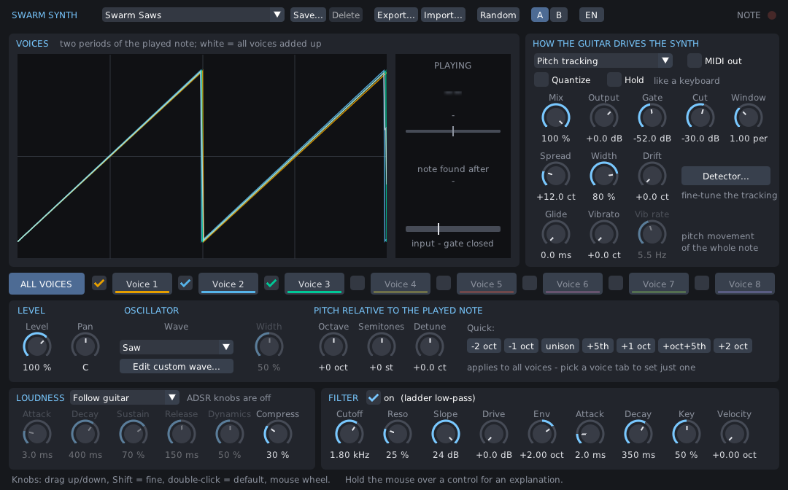

# Swarm Synth

> **[⬇ Download the plugins here](https://github.com/rafrowinski/vst-plugins/releases)** - ready-to-use Windows files.
> On that page, open the plugin you want and click the `.zip` file under **Assets**.

A VST3 guitar synthesizer built on the Swarm Chorus framework: up to 8 voices (oscillators) that play what the guitar plays -
each with its own wave, octave, interval, detune and stereo position. Monophonic: play single notes.

## Two ways to turn the guitar into a synth

The **Mode** switch. Both modes share the same voices, filter and envelopes - they differ only in where the oscillators
get their pitch from.

**Pitch tracking** - the detector recognizes the note and the oscillators play it. Clean, stable sound. A note can only
sound once the detector has seen about two of its periods, so the delay depends on pitch:

| note | Window 0.5 | Window 1.0 (default) | Window 2.0 |
|---|---|---|---|
| E2 (82 Hz, open low E) | 20 ms | 25 ms | 37 ms |
| A2 (110 Hz) | 15 ms | 20 ms | 27 ms |
| G3 (196 Hz) | 10 ms | 12 ms | 16 ms |
| E4 (330 Hz, open high e) | 7 ms | 7 ms | 10 ms |
| E5 (659 Hz) | 6 ms | 6 ms | 6 ms |

The plugin itself adds no buffer (zero latency reported to the host); only the audio interface buffer adds to these
numbers. The **Window** knob sets how many periods the detector compares: fewer = faster, but more prone to
mistakes. The measured delay of the last note is shown in the "note found after" field. Until a new note is
recognized the synth stays silent - the previous pitch never sounds under a new attack.

**Reshape (instant)** - no waiting for the detector. The guitar signal is turned into a rotating phase (analytic
signal) and the oscillators move by exactly that rotation, sample by sample. There is sound from the first
sample, and bends and vibrato come through instantly. The price is the attack: for the first milliseconds after the pick
the pitch is still settling (on the low strings for about one period of the note, i.e. around 10 ms you can hear
a short slide into the note from above). Once the detector has recognized the note, the reading is guarded: if a
harmonic wins, it is divided back down to the fundamental. **Glide** smooths the pitch in this mode.

The numbers in the table and the attack description come from tests on synthetic signals resembling a plucked string
(`tests/engine_test.cpp`), not from recordings of a real guitar.

## What else is inside

- **Voices**: wave (Sine, Triangle, Saw, Square / pulse with adjustable width, white and pink noise, Custom),
  Octave (-2..+2), Semitones (-12..+12; +7 = a fifth), Detune, Level, Pan. The Quick buttons set common
  intervals. The ALL VOICES tab sets all voices at once.
- **Spread**: Detune and Pan spread the enabled voices automatically. Neighbours in the stereo field get opposite
  detune so both sides sound full.
- **Custom wave** (one, shared by the voices set to Custom): points dragged with the mouse, a math formula
  or one cycle from a WAV file. The wave is converted to band-limited tables, so it does not alias
  on high notes.
- **Loudness**: Follow guitar (the synth is as loud as you play; **Compress** evens out the level while the note
  decays) or Synth ADSR (its own envelope, triggered by the pick; Dynamics = how much picking strength matters).
- **Gate** and **Cut**: Gate is an absolute input threshold. Cut ends the note once it drops by the given number of dB
  below its own peak - at the end of a decay the fundamental fades first and the pitch becomes unreliable.
  Below a quarter of the peak the note holds its last pitch anyway and does not jump to harmonics.
- **Filter**: ladder low-pass 6/12/18/24 dB, Reso, Drive, its own envelope (Env, Attack, Decay),
  Key tracking.
- **Quantize** and **Hold** (like on a keyboard): Quantize rounds the pitch to the nearest semitone. Hold keeps the note at full
  level even after the string has died out - until the next note or until you mute the strings (detected as a drop
  in level faster than a natural decay).
- **Vibrato** (depth and rate, comes in shortly after the note starts), **Velocity** to the filter (picking strength
  opens the filter), **Drift** (each voice slowly wanders in pitch on its own - for drones).
- **Detector...** (a window of detailed detector settings, each with a description): onset sensitivity and spacing,
  required reading clarity, confirmation time for legato / low notes / octave jumps, how the first reading is treated,
  freezing the pitch in the tail, playing the previous note until the new one is recognized. Three profiles:
  Fast solo, Balanced (default), Careful / let ring. On two real recordings Balanced produced a note sequence
  matching the recording, Fast solo added 6-7 false short notes in exchange for faster transitions.
  Your own detector settings can be saved, exported and imported (CSV) - see below.
- **Scatter / Converge**: every new note starts with the voices scattered by up to Scatter cents
  (1200 = an octave), and they slide together into the note over the Converge time - each voice at its own pace (from about half
  to one and a half times that time). A cloud that resolves into one sound, like a wall of free-running
  oscillators being tuned. Inspired by the
  [KiloDrone (LOOK MUM NO COMPUTER)](https://www.youtube.com/watch?v=c3wk9WWTfNs) - 1000 oscillators,
  each with its own tuning curve, meeting at one point. **Drone: Oscillator Wall** presets:
  scatter to unison (700 ct spread, converges in about 6 s), slow chaos (an octave, about 16 s), in tune (no scatter,
  just a dense wall). The filter is off in them: the brightness measured on the KiloDrone recording (spectral centroid
  around 500-650 Hz) comes out with 8 saws/pulses and no filter.
- **MIDI out**: recognized notes as note on/off with velocity, to drive another instrument (no pitch
  bend). Notes and timing are checked in the engine test; sending through the host has not been checked in REAPER.
  For full guitar-to-MIDI use [Guitar to MIDI Live](../guitar-to-midi-live).
- a playing-note indicator with the deviation in cents, input level with the Gate threshold marked
- factory and user presets, CSV export / import, Random, A/B - as in Swarm Chorus

## Saved detector settings

In the **Detector...** window, the **My settings** row:

- **Save...** stores the current detector settings under a name (Gate, Cut, Window and everything in the Detector window).
  The same name overwrites; the names of the built-in profiles (Fast solo, Balanced, Careful) cannot be used.
- the list next to it restores a saved setting; it also shows whether the current values match one of them
  or a built-in profile
- **Delete** removes the selected setting
- **Export...** writes the current settings or all saved ones to CSV
- **Import...** adds settings from a CSV file. Identical ones are skipped, the same name with different values gets
  "(2)". A Swarm Synth preset file works too - only its detector columns are used.

Saved settings are **shared by Swarm Synth and Guitar to MIDI Live** - one file,
`%APPDATA%\Guitar Detector\detector-presets.csv`. A setting saved in one plugin is immediately available in the other.

CSV format: the first row is the header, then one row per setting:

    name;gate;cut;track;det_clarity;det_legato;det_low;det_harm;det_probation;det_repick;det_refract;det_tail;det_bridge
    Tele bridge;-52;-30;1;80;20;30;40;60;1.5;40;25;1

`track` is Window. Import also accepts a comma or tab as the separator, a decimal comma
(a file from Excel), any column order and missing columns (the current values stay); out-of-range values
are clamped.

## Installation (Windows)

Copy `release/Swarm Synth.vst3` to `C:\Program Files\Common Files\VST3\` and in REAPER run
Options > Preferences > Plug-ins > VST > Re-scan. Put the plugin on the guitar track (before the amp
and effects - the detector works best on a clean signal).

User presets are saved in `%APPDATA%\Swarm Synth\user-presets.csv`.

## Custom wave

Text form (the `wave` column in CSV, the `wave` state in a project):

- `n:x,y;x,y;...` - points joined by a smooth curve (x = position in the cycle 0..1, y = 0..1, i.e. bottom..top)
- `l:x,y;x,y;...` - points joined by straight segments
- `f:formula` - e.g. `f:sin(2*pi*x) + 0.5*sin(4*pi*x)`; `x` runs 0..1 over one cycle
- `w:...` - one cycle loaded from a WAV file (256 16-bit samples, base64). The whole file is treated as
  one cycle, so single-cycle files work (PCM 8/16/24/32 bit or 32-bit float).

In a formula: `+ - * / ^`, parentheses, `pi`, `e`, the functions `sin cos tan asin acos atan sinh cosh tanh abs sqrt exp ln log10
floor ceil round frac sign min max pow mod clamp mix step`, and ready-made waveforms with period 1: `tri saw sqr`.
DC offset is removed and the wave is scaled to full height.

## Preset CSV format

One row = one preset. The first column is the name, the next ones are parameters (the header holds their symbols,
e.g. `mode`, `sp_detune`, `v1_wave`, `v3_detune`), the last one is `wave`. Separator `;`, decimal point.
Import also accepts `,` or tab, a decimal comma, any column order and missing columns.
Duplicates: same name and settings -> skipped; same name, different settings -> `Name (2)`.

## Code

The engine and detector are shared with Guitar to MIDI Live and live in [`shared/guitar-engine/`](../../shared/guitar-engine):

- `Params.hpp`   - parameter list, wave shapes, factory presets
- `Wave.hpp`     - custom wave: points, formula parser, WAV samples, compiling to a table
- `Tracker.hpp`  - pitch detector (NSDF with a window that grows with the period, refinement at the full
  sample rate)
- `Engine.hpp`   - DSP: both modes, oscillators, filter, envelopes, MIDI (no framework dependencies)
- `DetectorPresets.hpp` - saved detector settings and their CSV

In this folder:

- `src/PresetIO.hpp` - preset library, CSV, WAV loading
- `src/PluginDSP.cpp`, `src/PluginUI.cpp` - plugin and user interface (DPF + Dear ImGui)
- `tests/`           - tests that run without a host

## Tests

    g++ -O2 -std=c++17 tests/engine_test.cpp -o engine_test && ./engine_test
    g++ -O2 -std=c++17 tests/wave_preset_test.cpp -o wave_preset_test && ./wave_preset_test
    g++ -O2 -std=c++17 tests/scatter_test.cpp -o scatter_test && ./scatter_test

The first measures detector accuracy and delay, checks both modes on plucked notes (including ones with the second
harmonic stronger than the fundamental), intervals, legato and bends, 44.1 / 48 / 96 kHz, all presets
(NaN, level, CPU load) and MIDI notes. The second checks the custom wave, WAV loading and CSV. The third checks
that Scatter starts the voices spread out and that they come together.
The test of saved detector settings is in `shared/guitar-engine/tests/`.
`tests/jump_test.cpp` and `tests/tail_test.cpp` count pitch jumps on harder signals
(weak fundamental, previous note still ringing, hum, long decay).
`tests/host.cpp` is a minimal load test of the `.vst3` file (Windows / Wine).

## Building

All plugins are built together from the whole repository - see the [main README](../../README.md#building).
This plugin only (Linux -> Windows, this is how the included file was made), from the repository root:

    cmake -B build-win -DCMAKE_TOOLCHAIN_FILE=mingw.cmake -DCMAKE_BUILD_TYPE=Release
    cmake --build build-win --target swarm-synth-vst3

## License

The plugin code is MIT licensed - see [LICENSE](../../LICENSE). Third-party code (DPF, DPF-Widgets, Dear ImGui,
DejaVu Sans font) lives in `shared/` under its own licenses - details in the [main README](../../README.md#license).

## Trademarks

VST is a trademark of Steinberg Media Technologies GmbH.
